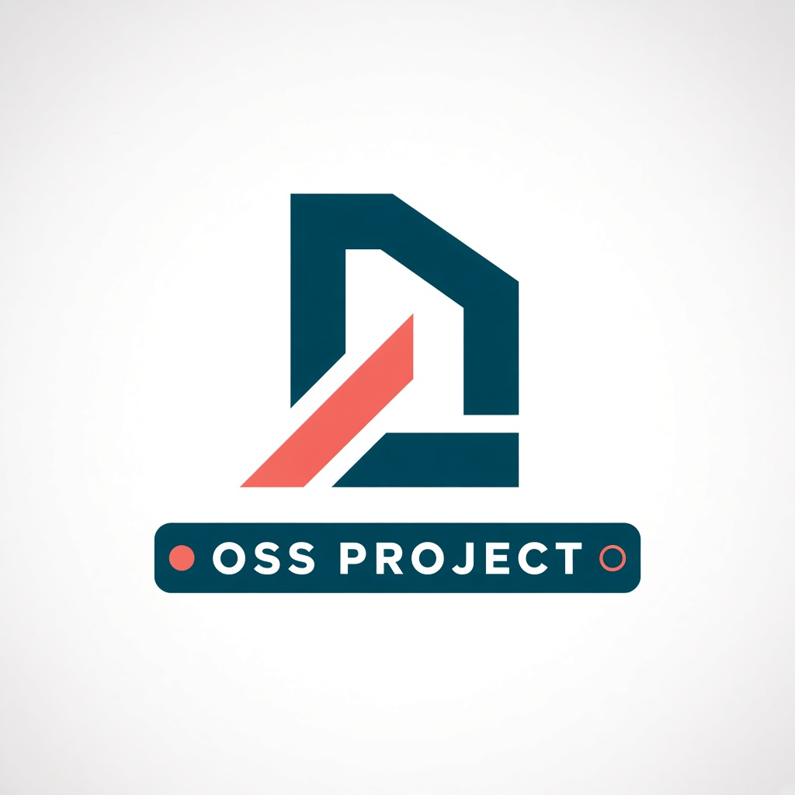

<p align="center">
  
</p>

<h1 align="center">gtav-enhanced-subs</h1>

<p align="center">
  Open toolkit for <b>Thai text</b> on <b>GTA V Enhanced</b> (Single Player)<br/>
  Dialogue · tips · UI · fonts · build CLI — not a closed subtitle dump
</p>

<p align="center">
  <a href="LICENSE"></a>
  <a href="https://github.com/aphsx/gtav-enhanced-subs/releases"></a>
  <a href="https://github.com/aphsx/gtav-enhanced-subs/issues"></a>
  
  
</p>

<p align="center">
  <a href="#-play">Play</a> ·
  <a href="#-translate">Translate</a> ·
  <a href="#-build--extend">Build</a> ·
  <a href="#-contributing">Contributing</a> ·
  <a href="#-license">License</a>
</p>

> Unofficial fan project. Own a legal copy of the game. **Not affiliated with Rockstar / Take-Two.**

---

## Why this repo

Typical Thai packs are zip-only. This one is structured like other OSS tools:

| Layer | What you get |
|-------|----------------|
| **Data** | Editable `edit/**/*.csv` (dialogue, tips, UI) |
| **Tools** | Python CLI — status, dump, build, font rebuild |
| **Docs** | Players / contributors / legal / roadmap |
| **Releases** | Optional DROP_IN for people who just want to play |

```text
edit/*.csv  →  tools/build.py  →  your mods/  →  optional Releases DROP_IN
```

## 🎮 Play

1. Open **[Releases](https://github.com/aphsx/gtav-enhanced-subs/releases)** → tag **0.0.1**
2. Download `GTA_V_Thai_Subs_DROP_IN.zip.001` + `.002` (split for GitHub’s 2 GB limit)
3. Join, extract into `Grand Theft Auto V Enhanced`
4. Language = **American / English** → Single Player

```powershell
Get-Content .\GTA_V_Thai_Subs_DROP_IN.zip.* -Encoding Byte -ReadCount 0 |
  Set-Content .\GTA_V_Thai_Subs_DROP_IN.zip -Encoding Byte
```

Full steps: [`PLAYERS.md`](PLAYERS.md) · risk note: [`LEGAL.md`](LEGAL.md)

## ✍️ Translate

No game required. Edit only column **`th`**.

| Path | Content |
|------|---------|
| [`edit/00_global_tips_emails.csv`](edit/00_global_tips_emails.csv) | Tips / emails / help |
| [`edit/dialogue/`](edit/dialogue/) | Mission / cutscene |
| [`edit/ui/`](edit/ui/) | Menus / UI (seed with dump) |

```powershell
python tools/status.py
```

Rules: [`RULES.md`](RULES.md) · index: [`edit/INDEX.md`](edit/INDEX.md)

## 🔧 Build & extend

Needs **your** game install + rpfpeek keys.

```powershell
pip install -r requirements.txt
python tools/status.py
python tools/dump_from_game.py --game "PATH\Grand Theft Auto V Enhanced"
python tools/build.py --game "PATH\Grand Theft Auto V Enhanced" --install
# or: .\install.ps1 -GameRoot "PATH\Grand Theft Auto V Enhanced"
```

Font rebuild: [`assets/FONTS.md`](assets/FONTS.md) · loaders: [`THIRD_PARTY.md`](THIRD_PARTY.md)

Do **not** commit `.rpf`, ASI, keys, or game dumps.

## 🤝 Contributing

PRs welcome — text, UI dumps, tools, fonts, docs.

- How: [`CONTRIBUTING.md`](CONTRIBUTING.md)
- Ideas: [`ROADMAP.md`](ROADMAP.md)
- Repo vs legacy packs: [`docs/STRUCTURE.md`](docs/STRUCTURE.md)

## 📄 License

**Not “everything is MIT.”** We only license what we can:

| Part | License | Who |
|------|---------|-----|
| Scripts / docs in this repo | **MIT** | You may use/fork freely (keep notice) |
| Community `th` column | **CC BY-SA 4.0** | Share-alike translations |
| Sarabun-derived font | **OFL 1.1** | See `assets/OFL-Sarabun.txt` |
| Rockstar `en` / game files | **© Rockstar** | Reference / your own copy only — **not** licensed here |

Putting MIT on the whole game or someone else’s pack would be wrong. Multi-license like this is normal for localization toolkits.

Full text: [`LICENSE`](LICENSE) · [`NOTICE.md`](NOTICE.md) · [`LEGAL.md`](LEGAL.md)
