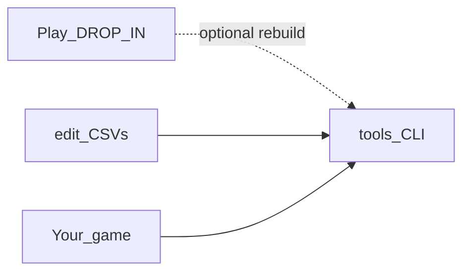

# GTA V Enhanced — Thai open toolkit

Unofficial open toolkit for **Thai text** (and more) on **GTA V Enhanced** SP.  
Own a legal copy of the game. Not affiliated with Rockstar.

This is not “subtitles only”: dialogue, tips, emails, **UI menus**, fonts, and build scripts are all in-repo for anyone to extend.

## Three ways in

| You want… | Do this |
|-----------|---------|
| **Play** | Download DROP_IN from [Releases](https://github.com/aphsx/gtav-enhanced-subs/releases) → [`PLAYERS.md`](PLAYERS.md) |
| **Translate / expand text** | Edit `th` in [`edit/`](edit/) → PR → [`CONTRIBUTING.md`](CONTRIBUTING.md) |
| **Build / dump / hack tools** | Clone → Python CLI against **your** game → [`ROADMAP.md`](ROADMAP.md) |



## Play (DROP_IN)

1. [Releases](https://github.com/aphsx/gtav-enhanced-subs/releases) → tag **0.0.1**
2. Download **`GTA_V_Thai_Subs_DROP_IN.zip.001`** + **`.002`**
3. Join parts, extract into `Grand Theft Auto V Enhanced`
4. Language **American / English** → SP

```powershell
Get-Content .\GTA_V_Thai_Subs_DROP_IN.zip.* -Encoding Byte -ReadCount 0 |
  Set-Content .\GTA_V_Thai_Subs_DROP_IN.zip -Encoding Byte
```

Details: [`PLAYERS.md`](PLAYERS.md) · legal risk: [`LEGAL.md`](LEGAL.md)

## Translate (no game required)

| Path | Content |
|------|---------|
| [`edit/00_global_tips_emails.csv`](edit/00_global_tips_emails.csv) | Tips / emails / help |
| [`edit/dialogue/`](edit/dialogue/) | Mission / cutscene lines |
| [`edit/ui/`](edit/ui/) | Menus / UI (seed with dump tool) |

Edit only column **`th`**. Rules: [`RULES.md`](RULES.md). Index: [`edit/INDEX.md`](edit/INDEX.md).

```powershell
python tools/status.py
```

## Build & extend (needs your game + keys)

```powershell
pip install -r requirements.txt
# coverage (no game)
python tools/status.py
# seed UI CSVs from your install
python tools/dump_from_game.py --game "PATH\Grand Theft Auto V Enhanced"
# pack + install into mods/
python tools/build.py --game "PATH\Grand Theft Auto V Enhanced" --install
# or
.\install.ps1 -GameRoot "PATH\Grand Theft Auto V Enhanced"
# font rebuild (optional): tools/rebuild_font.py — see assets/FONTS.md
# DROP_IN zip for Releases:
.\tools\make_dropin.ps1 -GameRoot "PATH\Grand Theft Auto V Enhanced"
```

Install a mods-folder loader yourself ([`THIRD_PARTY.md`](THIRD_PARTY.md)).  
Do **not** commit `.rpf`, ASI, keys, or game dumps.

Open ideas: [`ROADMAP.md`](ROADMAP.md) · how to help: [`CONTRIBUTING.md`](CONTRIBUTING.md)

## License

| Part | License |
|------|---------|
| Scripts / tools | MIT |
| Community `th` text | CC BY-SA 4.0 |
| Sarabun font source | OFL |
| Game EN / RPF in Releases | © Rockstar — not licensed by this project |

[`NOTICE.md`](NOTICE.md) · [`THIRD_PARTY.md`](THIRD_PARTY.md) · [`LEGAL.md`](LEGAL.md)
